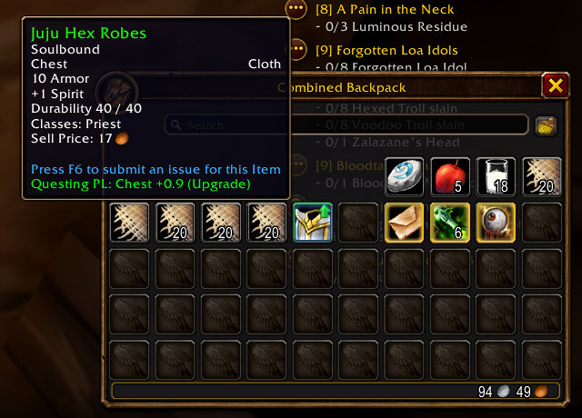
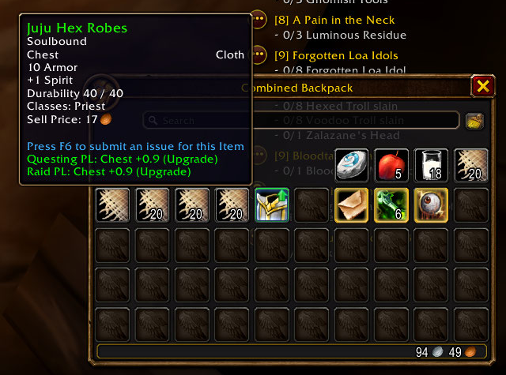
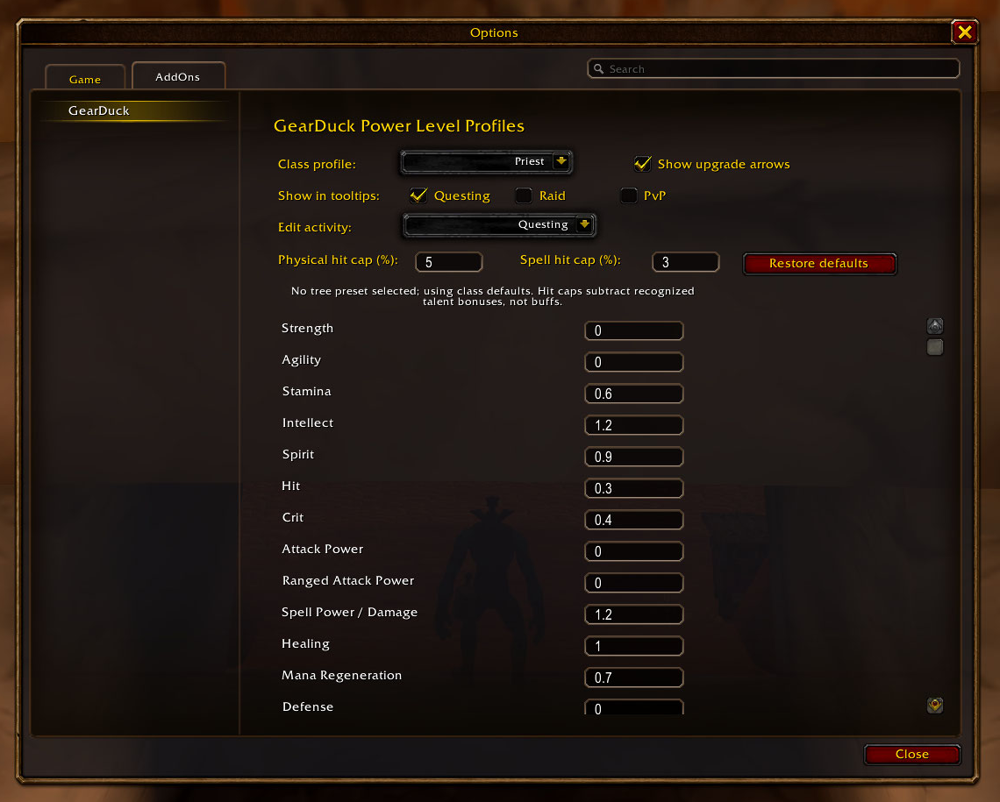
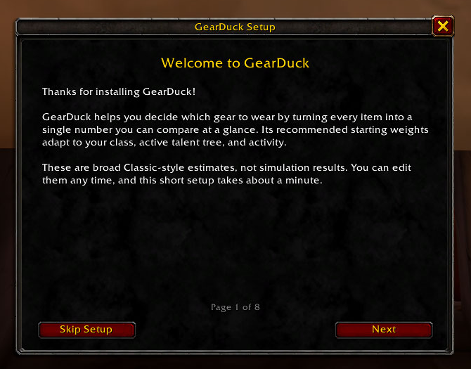

# GearDuck screenshot and publishing kit

## Capture status

Four genuine game-client captures are prepared as cropped PNGs. Each crop
retains the original pixels at native resolution: no upscaling, fabricated
values, overlays, or UI reconstruction. Cropping removes unrelated scenery,
chat, and character-name frames. Converting the source JPEGs to PNG prevents
additional lossy encoding but cannot restore detail lost in the originals.

All core screenshot subjects are covered. The settings image covers profile
selection, stat weights, hit caps, and the upgrade-arrow checkbox together;
the tooltip images also show an actual green bag upgrade arrow. There is no
need to upload duplicate crops just to give each control a separate image.

The original uncropped JPEGs have been removed after verifying the crops.

## Upload order, titles, and captions

Upload these PNGs to the CurseForge gallery in this order. Titles and captions
are ready to copy.

| Order | File | Size | Gallery title | Caption |
| --- | --- | --- | --- | --- |
| 1 | [01-tooltip-upgrade.png](screenshots/01-tooltip-upgrade.png) | 640 x 460 | Spot upgrades in your bags | GearDuck shows a Questing Power Level upgrade comparison for Juju Hex Robes, with a green upgrade arrow on the item in the backpack. |
| 2 | [02-tooltip-profiles.png](screenshots/02-tooltip-profiles.png) | 640 x 475 | Compare Questing and Raid profiles | View separate Questing and Raid Power Level comparisons on the same item tooltip. These starter profiles give the same result for this item; other items and custom weights can produce different results. |
| 3 | [03-options-weights.png](screenshots/03-options-weights.png) | 1140 x 915 | Tune your weights and display preferences | Choose tooltip profiles, toggle upgrade arrows, and edit class/activity stat weights and physical/spell hit caps in GearDuck's settings. |
| 4 | [04-setup-guide.png](screenshots/04-setup-guide.png) | 670 x 525 | Get started with GearDuck | The in-game setup guide introduces GearDuck and explains that its starter weights are broad estimates, not simulation results. Reopen it with /gd setup. |

The settings capture shows a low-level Priest with class defaults and no tree
preset selected. Do not label it as a talent-tree preset demonstration.
The setup capture shows the welcome page, not a later preference-selection
page.

## Gallery preview

### 1. Spot upgrades in your bags

### 2. Compare Questing and Raid profiles

### 3. Tune your weights and display preferences

### 4. Get started with GearDuck

## Optional captures still available to add

These are not required to publish the core gallery:

| Suggested filename | What to capture |
| --- | --- |
| `05-tooltip-cannot-use.png` | An item the character cannot equip, with GearDuck's `Cannot Use` result visible. |
| `06-tooltip-enchant.png` | An enchanted weapon tooltip with separate with-enchant and without-enchant comparisons visible. |
| `07-tooltip-different-results.png` | An item whose enabled activity profiles genuinely give different results, if you want to demonstrate that distinction. |

For any additional capture, keep the full-resolution original until a crop has
been checked, leave space around the tooltip or panel, and hide private chat
and account information before taking the screenshot. Do not change displayed
numbers in an image or imply a result the addon did not actually produce.

## Publishing notes

- Use the four PNGs directly; do not enlarge them or convert them back to JPEG.
- For CurseForge, upload the images through its gallery/editor. Relative
  Markdown links in this kit are local previews, not hosted public image URLs.
- Keep this media kit separate from the installable addon download. The
  repository's `.pkgmeta` excludes this versioned media folder from packaging.
