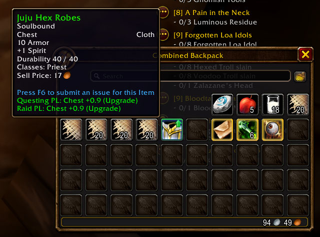
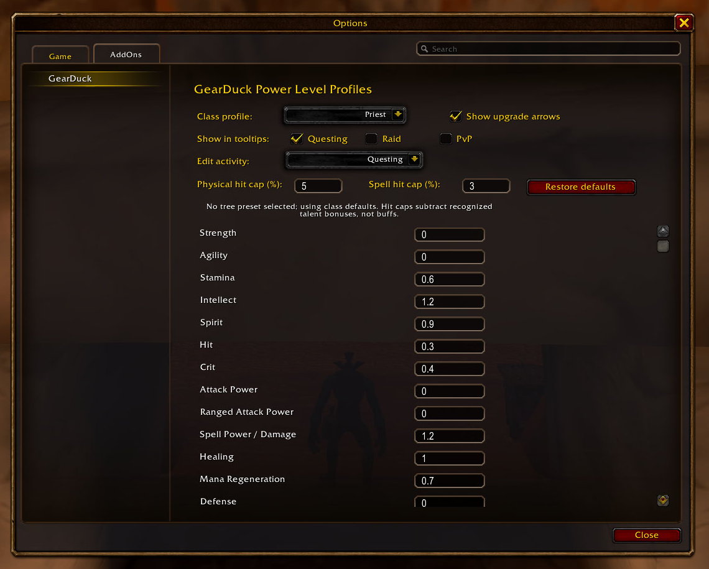
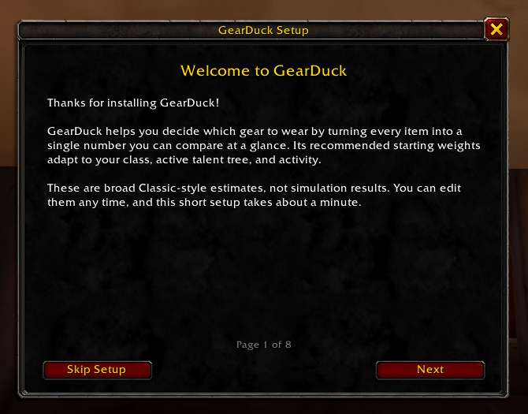

# GearDuck

GearDuck is a lightweight World of Warcraft: Forever addon that estimates item upgrades from editable, class-based stat weights. It adds a Power Level comparison to item tooltips and provides an in-game options panel for tuning weights.

> **Version:** 1.1.0-release | **Compatibility:** Built for WoW: Forever Beta 1.60.1 (`Interface: 16001`). The addon uses the modern item tooltip post-call API.

## Screenshots

### Spot upgrades and compare profiles

GearDuck adds Power Level comparisons to item tooltips and marks eligible bag upgrades with a green arrow. Enable multiple activity profiles to see their comparisons together.



### Tune your weights

Choose which profiles appear in tooltips, toggle upgrade arrows and choose their position, and edit class/activity weights and hit caps.



<details>
<summary>First-time setup guide</summary>

Reopen the in-game guide at any time with `/gd setup`.



</details>

[View the full gallery and captions](docs/SCREENSHOTS.md).

## Features

- Choose the upgrade arrow's position in `/gd options`: top right (default), top left, bottom right, bottom left, or a center overlay. The choice is saved per character and applies to Baganator arrows too.
- Detects your current class and selects its weight profile automatically. Profiles are provided for the nine original WoW Classic classes.
- Detects your active talent tree automatically and selects broad starter weights for that class/tree combination. Each tree's editable weights are independent within Questing, Raid, and PvP profiles. Talent data is cached and refreshed on talent/group changes.
- Factors supported racial weapon skill and weapon-specific talent effects into matching weapon subclasses.
- Compares an item against each applicable equipped slot. Rings, trinkets, and one-handed weapons show separate comparisons; classes that cannot dual-wield compare one-handed weapons against the main hand only. Two-handed weapons compare against both weapon slots together, and off-hand items account for removing an equipped two-handed weapon.
- Checks weapon and armor eligibility using explicit rules for all nine Classic classes; unusable items show `Cannot Use` instead of upgrade comparisons. Includes item-specific class restrictions (such as Shaman-only gear), level-20 polearm training, level-40 mail/plate unlocks, Shaman's two-handed weapon talent, and item required-level checks.
- Labels comparisons as upgrades, sidegrades, or downgrades.
- Includes weapon DPS and weapon speed in scoring when the item tooltip exposes damage and speed values, including speed displayed on the right side of a damage line and weapons without primary stats.
- Shows a small up arrow on visible item icons when an item is equippable and is an upgrade in at least one selected profile. Arrows are enabled by default and can be toggled in the options panel. Character and inspect equipment panes are excluded. Baganator category-view bags use its corner-widget API, while Blizzard individual and combined bags use the default UI's item-button enumerators and bounded refreshes after opening/updating. Other supported item panels refresh on bank, mail, quest, trade, and merchant updates, including buyback items. Item evaluations and equipped state are cached and recalculated when equipment, level, talents, or weights change; comparisons using unloaded equipped items are not cached.
- Loot-roll windows show upgrade arrows without hovering, and refresh them when equipped gear changes.
- Shows separate Power Level comparisons for an enchanted weapon with and without its enchant.
- Shows Questing comparisons by default, with options to show any combination of Questing, Raid, and PvP comparisons in that order. Each activity has its own class/tree starter weights and configurable hit caps.
- Scores supported unconditional set-bonus stats when a swap activates or breaks a piece-count threshold, using each displayed profile's weights. Unsupported set effects are flagged for manual valuation.
- Supports manual Power Level values for proc/use effects and set-bonus threshold overrides.
- Lets you edit separate class/activity stat-weight profiles in the AddOns settings panel. GearDuck stores them in the companion addon's SavedVariables file, independently of addon code updates.
- Shows a first-login setup guide for each character (explaining Power Level, then asking about stat weights, tooltip profiles, and upgrade arrows). Settings and stat weights are saved per character; reopen the guide with `/gd setup`.
- Includes `/gd debug` to print item stats, weighted contributions, and comparison math to chat.

## Install

1. In your WoW: Forever installation, open `Interface/AddOns`.
2. Copy both the `GearDuck` and `GearDuckWeights` folders from this repository into `Interface/AddOns`. Keep them as sibling folders.
3. Restart the client or type `/reload` if it is already running.

The installed path should look like this:

```text
Interface/
└── AddOns/
    ├── GearDuck/
    │   ├── GearDuckData.lua
    │   ├── GearDuckItems.lua
    │   ├── GearDuckSets.lua
    │   ├── GearDuckProfiles.lua
    │   ├── GearDuckTalents.lua
    │   ├── GearDuckEquipment.lua
    │   ├── GearDuckScoring.lua
    │   ├── GearDuckEvaluation.lua
    │   ├── GearDuckPresentation.lua
    │   ├── GearDuckOptions.lua
    │   ├── GearDuckUpgradeIndicators.lua
    │   ├── GearDuckOnboarding.lua
    │   ├── GearDuckHit.lua
    │   ├── GearDuck.lua
    │   └── GearDuck.toc
    └── GearDuckWeights/
        ├── GearDuckWeights.lua
        └── GearDuckWeights.toc
```

GearDuckWeights is a required companion addon. WoW writes its `GearDuckWeightsDB` SavedVariables to `WTF/.../SavedVariables/GearDuckWeights.lua` when the client saves addon data (normally at logout). The addon initializes all class/activity profiles with defaults on first launch; it cannot write arbitrary files into the installed addon folder.

## Commands

| Command | Description |
| --- | --- |
| `/gd setup` | Reopen the first-time setup guide. |
| `/gd help` | Show the addon command list. This is also shown by `/gd` with no argument. |
| `/gd debug` | Print the most recently hovered item's raw stats, weighted math, and slot comparisons. |
| `/gd options` | Open the GearDuck settings panel. |
| `/gd profile raid\|quest\|pvp` | Show only the selected profile. Use the AddOns options to select multiple profiles. |
| `/gd hitcap <value>` | Set both physical and spell hit caps for the selected class/activity, in percent. |
| `/gd hitcap physical\|spell <value>` | Set only the physical or spell hit cap for the selected class/activity. |
| `/gd itembonus <value\|clear>` | Set or clear a manual Power Level value for the currently hovered item. |
| `/gd enchantbonus <value\|clear>` | Set or clear a proc-only Power Level value for the hovered weapon enchant. |
| `/gd setbonus <pieces> <value\|clear>` | Set or clear a manual value for a hovered item's set at a piece-count threshold. |

`/gearduck` is an alias for `/gd`, so the same subcommands work with either prefix.

## Configure Weights

Use `/gd options` or open **Options → AddOns → GearDuck**. Select a class and an activity, then edit its numeric weights and physical/spell hit caps. The active character's talent tree is detected automatically; its weights are separate for each activity, and the tree picker is not needed. Press Enter or move focus away from a field to save its value. Set a weight to `0` to ignore that stat. **Restore defaults** resets the selected class/activity/talent-tree profile.

Available weights include Strength, Agility, Stamina, Intellect, Spirit, Hit, Crit, Attack Power, Ranged Attack Power, Spell Power / Damage, Healing, Mana Regeneration, Defense, Dodge, Parry, Armor, Weapon DPS, Weapon Speed Preference, Weapon Skill, Weapon-Specific Crit %, and Weapon-Specific Extra Attack %. Each class/activity/talent profile can be edited independently. Positive weapon-speed weights favor slower weapons; negative values favor faster weapons. Weapon-skill, crit, and extra-attack weights are heuristic Power Level units, not exact DPS simulations.

In the AddOns options, select one or more tooltip profiles; comparisons are displayed Questing, Raid, then PvP. Hit caps are stored independently for every class/activity combination as percentages. Defaults are 5% physical / 3% spell for Questing and PvP, and 9% physical / 16% spell for Raid. Item Hit is read from tooltip percentage lines, including spell-hit and additional enchant-hit lines, with item stats used as a fallback. Recognized talent hit bonuses are subtracted from the applicable cap; dual-wielding Warriors, Rogues, and Shamans use a 27% physical hit cap for raid white-hit scoring, with Shaman dual wield enabled only when its talent is active. Physical-only and spell-only classes use their relevant cap. Hybrid classes use the spell cap when their combined Spell Power and Healing weights exceed their combined Strength, Agility, Attack Power, and Ranged Attack Power weights; otherwise they use the physical cap, or the higher applicable cap if neither total is positive. This is a build-weight heuristic, not a damage simulation. Buffs, PvP defensive stats, and talent names/values not in GearDuck's recognized Classic mapping are not included.

## Tests

The standalone Lua regression harness checks SavedVariables migration, weighted item scoring, automatic set-bonus activation/loss, manual overrides, set-hit caps, item eligibility, and evaluation-cache invalidation with lightweight WoW API stubs. From the repository root, run it with Lua 5.1:

```text
lua tests\run.lua
```

These tests cover core calculations without launching the game. Use the WoW client to validate live tooltip rendering, options-panel behavior, bag hooks, and Baganator integration.

### Manual Effects

GearDuck cannot derive a reliable average value for every proc or use effect from tooltip text alone. Set an item-specific value while its tooltip is visible with `/gd itembonus 12`; clear it with `/gd itembonus clear`. The example value is added as 12 Power Level to that item's score.

Enchanted weapons show one comparison with the enchant field removed from the item link and one with the enchant intact. Static enchant stats returned by the item API are scored automatically. Proc-only enchant effects can be valued with `/gd enchantbonus 12` while hovering the enchanted weapon, and cleared with `/gd enchantbonus clear`.

Set bonuses are scored only when the hypothetical swap activates or breaks a threshold: adding a third piece gains the three-piece bonus, removing it loses that bonus, and swapping pieces without changing active thresholds adds nothing. The same comparison handles losing one set's bonus while gaining another's.

Automatic detection reads numbered set-bonus tooltip lines, including inactive bonuses, checking both client set-format globals rather than assuming they are identical. Supported effects are unconditional Strength, Agility, Stamina, Intellect, Spirit, Armor, Attack Power, Ranged Attack Power, generic Spell Power, Healing, mana per 5 seconds, Defense, and recognized Hit/Crit/Dodge/Parry percentage descriptions. Primary stat names, short Attack Power/Ranged Attack Power lines (such as `+10 Attack Power`), armor, and the set-line format use client-localized labels; effect descriptions currently recognize English Classic wording. No item-specific bonus entries are needed for supported tooltip stats. Set Hit is capped together with the rest of the loadout. Bonuses stay separate from the item's individual score and appear in comparison math under `/gd debug`.

Active green bonuses can display only `Set: ...`, hiding their piece counts. GearDuck automatically learns thresholds from numbered gray lines and saves those descriptions per set in SavedVariables, shared across characters and retained across reloads. It then matches active descriptions to those learned thresholds, so replacing an equipped set piece accounts for losing the bonus too. If a set is already active when first encountered, briefly unequip enough pieces to make its bonuses gray and hover a set item, then re-equip. Until the thresholds are learned (or if matching is ambiguous), GearDuck flags the comparison as incomplete instead of assuming thresholds from line order or silently treating the active bonus as zero. Learning stores tooltip definitions, not fixed scores; each profile still applies its own weights.

Conditional effects, procs, school-specific damage, weapon-specific skills, and unrecognized wording are not guessed. If a swap crosses an unsupported threshold, the tooltip flags it and `/gd debug` identifies the effect. Missing set tooltip data is also flagged and retried rather than cached.

For these effects, hover an item from the set and enter an estimated value at its threshold, for example `/gd setbonus 2 15` for a 15-point value when the equipped count reaches two pieces. A manual value **replaces the entire automatic value at that threshold**, not adds to it, including when the value is `0`. Existing saved values retain this override behavior. Use `/gd setbonus 2 clear` to remove the override and restore automatic scoring where supported.

## How Power Level Works

The addon reads item stats through the WoW item API and multiplies them by the selected class/talent profile's weights. Negative stat values are included as penalties in the weighted score. For weapons, it reads damage and speed from localized tooltip formats and derives DPS as average damage divided by speed. The result is a relative estimate, not an in-game character rating.

The initial profiles are editable, broad level-60 Classic-style estimates, not simulation-derived weights. Starter weights vary by class, major talent tree, and activity: Questing is the general baseline, Raid adjusts priorities such as hit and mana sustain, and PvP emphasizes survivability. These are intended to be useful starting points, not precise rankings: gear, encounter, talents, role, and playstyle can change stat values (notably hybrid roles such as Feral Druids and Protection Warriors). Customize them when you can, and check `/gd debug` to inspect the active class/talent profile, item stats, and comparison math. Existing saved custom weights are preserved when defaults are updated.

The hit-cap talent scan recognizes Warrior/Paladin/Rogue Precision, Hunter Surefooted, Mage Arcane Focus, Priest Shadow Focus, Warlock Suppression, Druid Balance of Power, and Shaman Elemental Precision using Classic rank values, including Forever's three-rank Rogue Precision. Talent effects are heuristic and unsupported custom talent changes are not inferred. The rest of the scan recognizes Classic racial skill bonuses; Warrior/Rogue weapon-specific crit and sword extra-attack talents; Hunter ranged-weapon damage specialization; and Warrior/Paladin one- and two-handed damage specializations. Weapon skill affects its own term; crit and extra attacks use their separate profile weights; damage talents scale the parsed weapon DPS contribution. These are simplified expected-value heuristics and do not model rotations, proc interactions, or encounter-specific uptime. Stun/control talents are not counted as direct DPS. Other proc/use effects and unsupported set bonuses require manual values; proc-only enchant value can be set separately.

Equipability uses hard-coded Classic class proficiency rules rather than the client equipability API. It assumes a character has trained weapon types that their class can learn; the addon does not inspect the character's learned weapon-skill lines or parse item-specific class restrictions. Polearm, armor-level, Shaman talent, and item required-level gates are checked explicitly.
